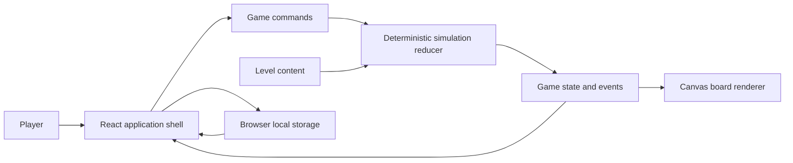
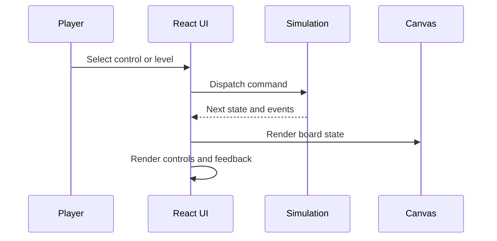
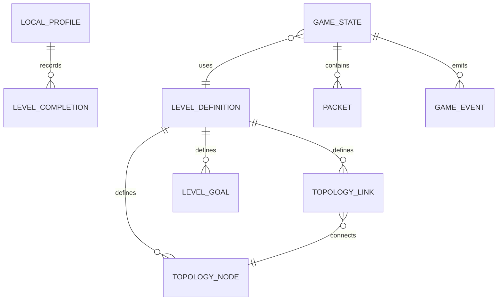

# Kernel Architect Solution

## Overview

### Description

Kernel Architect is a local browser game about infrastructure systems.

The application runs a deterministic level simulation and renders the current state through React and Canvas.

The application does not use an account, network API, payment service, analytics service, or multiplayer service.

### Expected Load

One browser tab runs one active game session for one player.

The solution targets current desktop browsers during normal level play.

### Technology Stack

- TypeScript implements game and application code.
- React implements controls, overlays, and application state orchestration.
- Vite builds and serves the browser application.
- Canvas renders the level board and simulation visuals.
- Browser local storage retains non-sensitive progress and settings.

### Design Decisions Summary

- Use an immutable reducer state for deterministic game rules.
- Use a fixed simulation step that does not depend on Canvas draw frequency.
- Keep React controls separate from Canvas board rendering.
- Validate saved data and use default data after invalid or incompatible data.
- Test simulation rules without browser or rendering dependencies.

## High-Level Architecture Design

The application separates content, simulation, persistence, and presentation.

The UI sends explicit commands to the simulation reducer.

The reducer returns the next game state and events.

React renders controls and feedback from this state.

Canvas renders the board from this state.





## System Modules

### Application Shell

**Responsibilities**

The application shell loads saved data, selects a level, manages the fixed update loop, and holds UI state.

**Key Components**

- `src/App.tsx`
- Level selection view
- In-game controls
- Status and result overlays

**Key Interfaces**

The shell sends `GameCommand` values to the simulation reducer.

The shell receives `GameState` and `GameEvent` values.

**Dependencies**

The module depends on React, game content, simulation functions, Canvas rendering, and browser local storage.

**Error Handling**

The shell uses default progress and settings if saved data is absent, invalid, or incompatible.

### Simulation Module

**Responsibilities**

The simulation module applies player commands and fixed-step updates.

It calculates routing, packet behavior, component state, score, goals, failures, and recovery.

**Key Components**

- `src/game/sim.ts`
- State reducer
- Fixed-step update function
- Event generation rules

**Key Interfaces**

`reduceGameState(state, command)` returns the next immutable state and generated events.

`advanceGameState(state, stepMs)` returns the next immutable state and generated events.

**Data Models**

The module uses level state, topology entities, links, packets, routes, goals, score, and event records.

**Dependencies**

The module depends on static level content only.

The module does not depend on React, Canvas, local storage, or browser APIs.

**Error Handling**

The module rejects commands that the active level does not permit.

The module leaves valid state unchanged for unsupported or unavailable actions.

### Content Module

**Responsibilities**

The content module defines level topology, initial state, available commands, learning text, and goal rules.

**Key Components**

- `src/game/content.ts`
- Level definitions
- Tutorial and explanation data

**Key Interfaces**

The module provides a level definition by level identifier.

**Data Models**

A level definition contains nodes, links, initial entities, objectives, controls, and explanatory text.

**Dependencies**

The module is independent from React, Canvas, and browser APIs.

**Error Handling**

The application uses a known default level if it cannot resolve a requested level identifier.

### Canvas Renderer

**Responsibilities**

The Canvas renderer draws topology, links, packet movement, state indicators, and board feedback.

**Key Components**

- Canvas element
- Render functions for topology entities and links

**Key Interfaces**

The renderer accepts a read-only render model from `GameState`.

The renderer does not issue simulation commands.

**Dependencies**

The renderer depends on Canvas APIs and the game render model.

**Error Handling**

The renderer skips an unavailable visual asset or optional visual detail without changing simulation state.

### Persistence Module

**Responsibilities**

The persistence module saves and restores completion state and settings.

**Key Components**

- Storage schema version
- Parser and validator
- Default progress and settings factory

**Key Interfaces**

`loadLocalProfile()` returns a validated local profile or default data.

`saveLocalProfile(profile)` writes a validated non-sensitive profile.

**Data Models**

The local profile contains schema version, completed level identifiers, and player settings.

**Dependencies**

The module depends on browser local storage only.

**Error Handling**

The module discards malformed, unsupported, or unavailable saved data.

The module does not block game start when a storage operation fails.

## Data Model



### Entity Descriptions

- `LevelDefinition` defines the static level topology, controls, goals, and learning text.
- `TopologyNode` represents a service, infrastructure component, or other level node.
- `TopologyLink` represents a directed or bidirectional connection between topology nodes.
- `GameState` contains all mutable state for one active level session.
- `Packet` represents simulated traffic and its current route or outcome.
- `GameEvent` records an observable simulation outcome for UI feedback.
- `LevelCompletion` records local completion status for a level.
- `LocalProfile` stores schema version, completion records, and settings on one browser device.

## API / Protocol Design

The current application has no network API, messaging protocol, WebSocket, or external protocol.

The internal command boundary uses typed in-process calls.

### Command Schema

```ts
type GameCommand =
  | { type: 'SELECT_LEVEL'; levelId: string }
  | { type: 'START' }
  | { type: 'PAUSE' }
  | { type: 'RESUME' }
  | { type: 'RESET' }
  | { type: 'CHANGE_ROUTE'; nodeId: string; targetId: string };
```

The implementation can extend this union only for controls that current level content exposes.

### Error Codes

The application does not expose network error codes.

The UI can map internal conditions to local status messages such as `INVALID_COMMAND`, `INVALID_SAVED_DATA`, and `LEVEL_NOT_FOUND`.

## Security Architecture

### Authentication and Authorization

The current application has no authentication, authorization, account, or identity flow.

### Input Validation

The application validates player commands against active level rules.

The application validates parsed browser-local data before it uses the data.

### Data Protection

The application stores no secrets, credentials, payment data, or personal data.

The application treats browser local storage as non-sensitive and editable by the local device user.

## Deployment and Operations

### Infrastructure Layout

Vite produces static browser assets for a static hosting environment.

The deployed client runs without a required application server.

### Scaling Strategy

Static hosting scales independently from game sessions.

Each browser runs its own simulation and stores its own local profile.

### Configuration

Build configuration defines the Vite build and static asset paths.

Level content is part of the shipped client bundle.

The current application has no runtime secrets or server configuration.

## Testing Strategy

Test the simulation module with deterministic unit tests.

Cover routing, packet state, failure behavior, recovery behavior, score calculation, goal completion, invalid commands, pause behavior, and reset behavior.

Use fixed initial state and command sequences for each test.

Assert the next state and generated events.

Add a regression test for each corrected simulation defect.

Manually verify level selection, start, pause, resume, reset, completion feedback, and local progress restoration in a supported browser.

## Success Criteria

- The same level state and command sequence produce the same simulation outcome.
- The player can select, start, pause, resume, and reset every current level.
- The player receives visible goal, status, event, failure, and completion feedback.
- The application restores valid local completion state and settings after a browser reload.
- The application starts with default data when local saved data is invalid or unavailable.
- The game remains responsive without any network connection or external service.

## Key Solution Decisions

### Use a Fixed Simulation Step

A fixed step prevents frame-rate-dependent game rules.

React and Canvas can render independently from simulation progress.

An animation-frame simulation was rejected because browser draw frequency can vary.

### Use an Immutable Reducer

An immutable reducer makes state transitions explicit and testable.

The reducer supports reproducible test cases from a state and command sequence.

A mutable simulation object was rejected because it makes regression diagnosis less direct.

### Use React and Canvas Together

React manages controls, overlays, and status text.

Canvas renders the dynamic topology board efficiently.

A DOM-only board was rejected because Canvas better matches the existing board rendering approach.

### Use Defensive Local Storage

A versioned schema supports safe future profile changes.

Invalid saved data cannot prevent the player from starting the game.

Direct restoration was rejected because local storage can contain malformed or obsolete data.

## Deliberate Shortcuts

### Local-Only Profile

The current game stores progress on one browser device only.

This shortcut is valid while the game has no account or cross-device progress requirement.

Add a backend identity and cloud-save design if cross-device progression becomes a product requirement.

### No External Telemetry

The current game collects no analytics, crash reports, or player data.

This shortcut is valid while product operation does not require usage measurement or remote diagnostics.

Add a privacy-reviewed telemetry plan before any data collection.

### No Multiplayer

The current game simulates one local player session.

This shortcut is valid while no shared game state exists.

Design server authority before any multiplayer feature work.

## Out of Scope

- Native desktop, mobile, console, and game-engine builds.
- Accounts, identity, cloud saves, and cross-device progress.
- Multiplayer, matchmaking, chat, invites, and leaderboards.
- Payments, in-app purchases, advertisements, and store integration.
- Analytics, remote configuration, A/B tests, and external telemetry.
- External network APIs and server-managed game state.